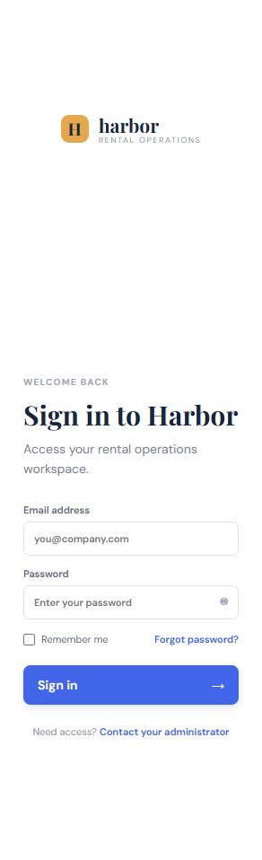

# Rental360 DevOps verification — 2026-10-26

This record contains checks performed against the current repository, local
Docker Desktop, the available Kubernetes cluster, Jenkins, and the configured
Render URL. No production deployment was performed.

## Rubric status

| Area | Status | Evidence |
|---|---|---|
| M1 repository hygiene | Verified complete | `scripts/hygiene.sh`, CI hygiene job |
| M2 application baseline | Verified complete | `test/test.js`, `server.js` legacy endpoints |
| M3 CI build/test | Implemented and locally verified | `.github/workflows/ci.yml`, backend tests, frontend build |
| M4 Docker | Verified locally | `Dockerfile`, `frontend/Dockerfile`, Compose build/config |
| M5 deployment configuration | Implemented, not externally deployed | `Jenkinsfile`, `k8s/`, Compose runtime |
| M6 hosted deployment and monitoring | Local monitoring verified; hosted deployment incomplete | local Prometheus/Grafana checks; Render status below |
| M7 Kubernetes | Existing cluster rollout verified for legacy image; MERN manifests validated only | `kubectl` checks and `k8s/*.yaml` |

## Local runtime verification

Docker Desktop was running with Docker Engine 29.8.2. The following services
started successfully:

- Frontend: `http://localhost:5173`
- API: `http://localhost:8081`
- MongoDB: `mongodb://localhost:27017`
- Prometheus: `http://localhost:9090`
- Grafana: `http://localhost:3001`

The named MongoDB volume `devops-24eskcs137_rental360-mongo` was preserved.

Verified:

- API `/health`: `{"status":"ok","commit":"local-validation","database":"ready"}`
- API `/ready`: `{"status":"ready"}`
- API `/metrics`: Prometheus metrics response
- Frontend HTTP response: 200
- Frontend browser login, dashboard, Properties page, and logout
- Demo seed script
- Authentication and protected API rejection
- Live database dashboard values
- CRUD reads for properties, units, tenants, leases, invoices, payments,
  utilities, and maintenance
- Real property create/update/delete against MongoDB
- Payment creation reconciles invoice `paidAmount`; deleting the payment
  restores the prior balance
- Cross-owner property update rejected with HTTP 404
- Prometheus targets `prometheus` and `rental360`: both `up`
- Grafana `/api/health`: HTTP 200

## Render verification

URL: `https://devops-24eskcs137.onrender.com`

- `/health`: HTTP 200
- `/health` body: `{"status":"ok","commit":"local"}`
- `/metrics`: HTTP 404 (`Not Found`)

The hosted URL is reachable, but it is not serving the current MERN API and
cannot be marked as a successful current deployment.

## Kubernetes verification

`kubectl cluster-info` succeeded against the local Docker Desktop cluster.
The existing `default/rental360` deployment reported:

- rollout: successful
- pod: `1/1 Running`
- service endpoint: `10.244.0.6:3000`
- image: `rental360:local`
- readiness probe: `/health`
- liveness probe: `/health`

This is the pre-existing legacy deployment. The current MERN manifests were
validated with `kubectl create --dry-run=client`, but were not applied because
their local images and MongoDB secret are not loaded into the cluster.

## Jenkins and GitHub Actions

- Jenkins Windows service: running
- Jenkins web UI: HTTP 200
- Jenkins API: HTTP 403 (authentication required), so no pipeline execution
  was claimed
- GitHub CLI: unauthenticated, so remote Actions run status could not be read
- CI workflow configuration was inspected and uses real `npm ci`, backend test,
  frontend build, and Docker image build steps

## Commands and results

| Command/check | Result |
|---|---|
| `npm --prefix backend test` | 3 passing |
| `npm --prefix frontend run build` | passed |
| `node test/test.js` | passed |
| `npm audit --omit=dev` backend | 0 vulnerabilities |
| `npm audit --omit=dev` frontend | 0 vulnerabilities |
| `docker compose config` | valid |
| Docker Compose image builds | passed |
| `kubectl create --dry-run=client` for manifests | passed |
| `git diff --check` | passed |

Remaining external blockers are Render redeployment, authenticated GitHub
Actions inspection, and authenticated Jenkins pipeline execution.
